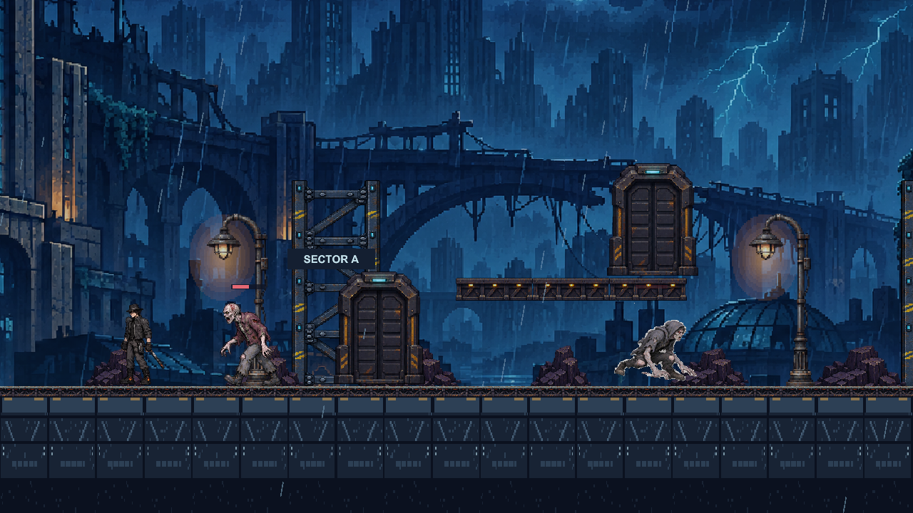

# Moon Shadow

Metroidvania de acción 2D desarrollado en **Unity 6000.6.9f1**, con combate de espada, armas de fuego, exploración y una campaña de cinco actos. Kyle atraviesa una ciudad en ruinas y continúa hasta la base lunar para rescatar a Sofy.



**Versión jugable:** [v0.9.2 — Windows y Android](https://github.com/tantan15711/moon-shadow/releases/tag/v0.9.2).

## Jugar

Descarga los archivos de la sección [Releases](https://github.com/tantan15711/moon-shadow/releases).

| Plataforma | Archivo | Cómo iniciar |
| --- | --- | --- |
| Windows de 64 bits | `Moon.Shadow.PC.0.9.2.zip` | Extraer el ZIP completo y ejecutar `Moon Shadow.exe`. Mantener la carpeta de datos y las DLL junto al ejecutable. |
| Android 8.0 o superior | `Moon.Shadow.Android.0.9.2.apk` | Copiar el APK al dispositivo e instalarlo. ARM64/ARMv7 y OpenGL ES 3; orientación horizontal. |

La versión de Android incluye controles táctiles. El APK de esta entrega está firmado para instalación directa y pruebas; no es una publicación de Google Play.

## Sistemas del juego

- Combos de espada encadenados, ataques fuertes, parry y dash con daño.
- Disparos continuos dirigidos con ratón o stick derecho; cargadores, recarga y armas legendarias con munición infinita.
- Zonas interconectadas, plataformas móviles, arenas de combate y encuentros con jefes.
- Enemigos con tácticas y ataques específicos; barras de vida sobre los objetivos.
- Rescate de civiles, inventario, tienda, mejoras y botiquines de uso manual.
- Conversaciones sobre los personajes que avanzan mediante una acción del jugador.
- Teclado/ratón, mando Xbox y pantalla táctil; consejos adaptados al dispositivo.
- Partidas guardadas y continuación de la campaña mediante `PlayerPrefs`.

## Controles

| Acción | Teclado y ratón | Mando Xbox |
| --- | --- | --- |
| Mover | A / D o flechas | Stick izquierdo / cruceta horizontal |
| Caminar | Ctrl | Inclinación del stick izquierdo |
| Saltar | Espacio | A |
| Espada / ataque fuerte | J o clic izquierdo / L | X / Y |
| Apuntar / disparar | Ratón / mantener F | Stick derecho / mantener RT |
| Recargar | R | B |
| Parry | K o clic derecho | LB |
| Dash | Shift | RB |
| Curarse / interactuar | H / E | Cruceta arriba / abajo |
| Inventario / visor | I / Q | View / pulsar stick derecho |
| Pausa | Escape | Menú |
| Elegir / aceptar | W/S o flechas / Enter | Stick o cruceta / A |
| Avanzar diálogo | Clic izquierdo o Enter | A |

En Android, el stick izquierdo mueve y el derecho apunta y dispara mientras se arrastra. Los botones de acción, pausa e inventario aparecen en pantalla; los menús muestran **ACEPTAR** y **VOLVER**.

## Abrir el proyecto

1. Instalar **Unity 6000.6.9f1** mediante Unity Hub, con soporte de Windows. Para Android, añadir Android Build Support, SDK, NDK y OpenJDK.
2. Clonar este repositorio y añadir su carpeta raíz en Unity Hub.
3. Dejar que Unity restaure los paquetes de `Packages/manifest.json` y termine de importar los recursos.
4. Abrir `Assets/_Project/Scenes/Inicio.unity` y entrar en Play.

Las seis escenas de distribución ya están guardadas y habilitadas en Build Settings. El menú **Moon Shadow → Preparar campaña** permite reconstruir la configuración de campaña al modificar los generadores; no es necesario ejecutarlo para jugar el proyecto clonado.

## Compilar y verificar

Las exportaciones se realizan con `MoonShadow.Editor.DistributionBuild.Windows` y `MoonShadow.Editor.DistributionBuild.Android`. Las instrucciones completas están en [la guía de desarrollo](docs/DEVELOPMENT.md).

Las pruebas de campaña y entrada táctil pueden ejecutarse desde PowerShell en Windows:

```powershell
.\Tools\Run-QA.ps1 -Mode Campaign -Editor "C:\Program Files\Unity\Hub\Editor\6000.6.9f1\Editor\Unity.exe"
.\Tools\Run-QA.ps1 -Mode TouchReview -Editor "C:\Program Files\Unity\Hub\Editor\6000.6.9f1\Editor\Unity.exe"
```

El ejecutable de QA usa el nombre de producto `Moon Shadow QA` para aislar las partidas de prueba de las del juego. Los informes y capturas se guardan en `_Logs/`, fuera del historial Git.

## Organización

| Ruta | Contenido |
| --- | --- |
| `Assets/_Project/Scenes` | Inicio y los cinco actos de la campaña |
| `Assets/_Project/Scripts/Player` | Movimiento, entrada y acciones de Kyle |
| `Assets/_Project/Scripts/Combat` | Combos, armas, munición y efectos |
| `Assets/_Project/Scripts/Enemies` | Enemigos, tácticas y técnicas de ataque |
| `Assets/_Project/Scripts/World` | Campaña, animación, guardado y rendimiento |
| `Assets/_Project/Scripts/UI` | Menús, HUD, inventario y controles táctiles |
| `Assets/_Project/Editor` | Generadores de escenas y exportación |
| `Assets/_Project/Art` y `Audio` | Recursos visuales y de sonido |
| `Tools/QA` | Pruebas automatizadas y revisión de movimiento |
| `docs` | Desarrollo, validación, notas de versión y prompts de arte |

## Estado de la entrega

La campaña y los controles táctiles pasaron las pruebas automatizadas. Se verificaron el arranque de Windows, la firma del APK y su instalación en el emulador. **El rendimiento en un teléfono físico sigue pendiente de validación.** Consulta [el informe de validación](docs/VALIDATION.md) y [las notas de v0.9.2](docs/RELEASE_NOTES_0.9.2.md).

Se conservan los archivos `.meta` de Unity para mantener las referencias de los recursos. Las cachés, herramientas descargadas, ajustes personales y compilaciones se excluyen de Git; las distribuciones jugables se adjuntan a Releases.

¡Gracias por jugar! :)
